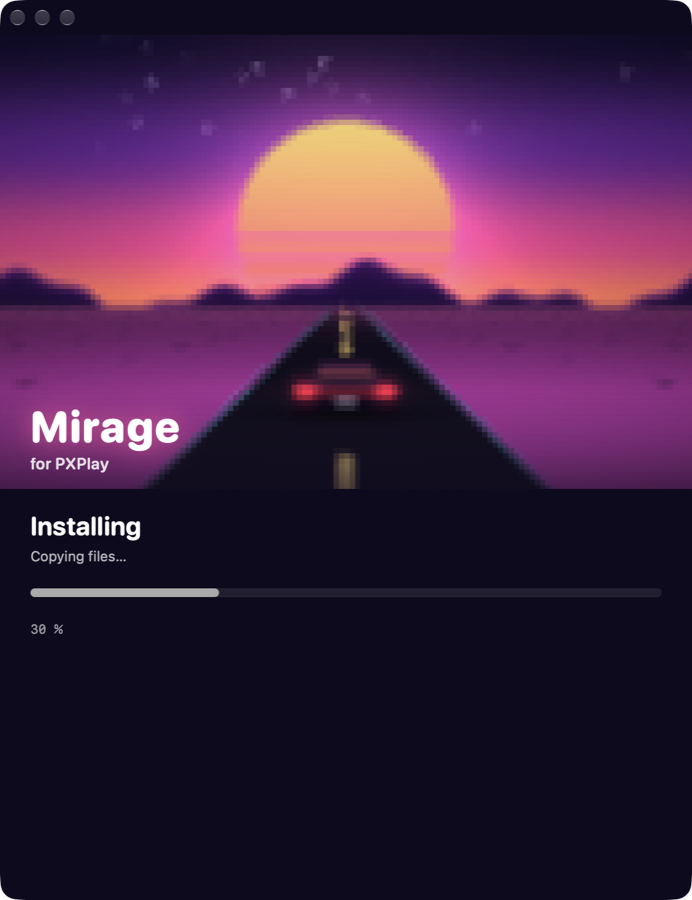
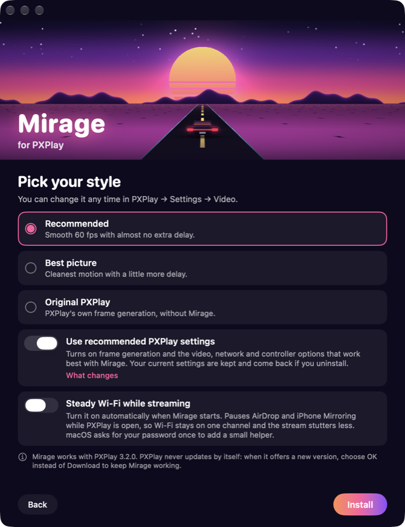
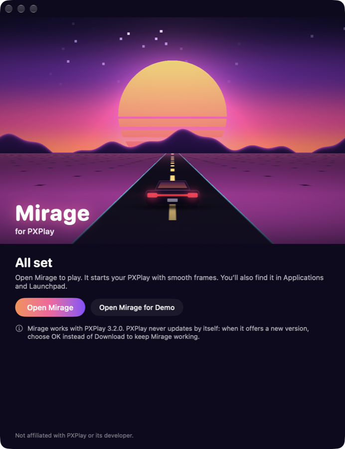

<p align="center"></p>

<h1 align="center">Mirage for PXPlay</h1>

<p align="center">Smooth 60 fps frame generation for <b>PXPlay 3.2.0</b> and <b>PXPlay Demo 3.2.0</b> on Apple silicon Macs.<br>
<a href="#русский">Читать по-русски</a></p>

> **Not affiliated with PXPlay or its developer (streamingdv).** PXPlay is a paid app by its own developer.
> Mirage does not include, copy or change any part of it — buy PXPlay from its developer.

---

## What it does

PXPlay streams your PlayStation to the Mac. Mirage adds an extra, AI-generated frame between the ones
the console sends, so a 30 fps stream looks like 60 fps:

- **RIFE 4.25 on the Mac's GPU** (Metal), with a prediction mode that shows the real frame at once and
  the generated one right after — smooth motion with almost no extra delay.
- **Steady HUD and text:** parts of the picture that don't move (quest text, subtitles, minimap) stay sharp.
- **Three simple styles** in PXPlay → Settings → Video: *Recommended*, *Best picture*, *Original PXPlay*.
  Fine-tuning hides under *More options*.
- **Steady Wi‑Fi (optional):** pauses AirDrop and iPhone Mirroring while PXPlay is open, so the Wi‑Fi
  radio stays on your network's channel and the stream stutters less.
- **Your language:** all twelve languages PXPlay offers.

<p align="center">
  
  
  
</p>

## Requirements

- A Mac with Apple silicon (M1 or newer)
- macOS 26 or later
- [PXPlay 3.2.0 or PXPlay Demo 3.2.0](https://github.com/streamingdv/PSPlay-Application-Hosting/releases/tag/v3.2.0_v9.0.0)
  (the official release; other versions are detected and Mirage stays off)

The Demo works too, within its usual 30-minute sessions.

## Install

1. Download `Mirage-for-PXPlay-1.0.0.zip` from [**Releases**](https://github.com/d00d1k/mirage-for-pxplay/releases) and open it.
2. **First open (once):** Mirage Installer isn't notarized by Apple yet, so macOS stops it the first time.
   - Double-click **Mirage Installer**, then click **Done** in the warning.
   - Open **System Settings → Privacy & Security**, scroll down, click **Open Anyway** next to Mirage Installer,
     and confirm with your password or Touch ID.
3. The installer finds PXPlay by itself (you can also drag PXPlay onto its window or click **Choose…**).
4. Pick a style, keep **Use recommended PXPlay settings** on, and click **Install**.
5. Open **Mirage for PXPlay** from Applications or Launchpad and play.

The apps the installer creates open normally; only the installer needs the step above.
With a Developer ID signature and Apple notarization this warning would disappear entirely — that's planned
for a later release.

## How it works

- The installer copies Mirage to `~/Library/Application Support/Mirage for PXPlay` and creates
  **Mirage for PXPlay** (and **Mirage for PXPlay Demo**) in `~/Applications`.
- That small app starts **your own PXPlay**, wherever it is, with Mirage's Java agent attached through
  `JAVA_TOOL_OPTIONS`. PXPlay's app bundle is never copied or modified; opening PXPlay directly still runs it without Mirage.
- Mirage checks that it's really PXPlay 3.2.0 for Apple silicon (version, files, the developer's signature
  and the exact classes it touches). For anything else it does nothing.
- Two PXPlay classes get a one-line call into Mirage, **in memory only**, while PXPlay runs.
- If PXPlay moves, the launcher finds it again.

### PXPlay updates

PXPlay never updates by itself. When a new version comes out, it shows a notice once with **OK** and
**Download**. Choose **OK** to keep Mirage working. If you do install a newer PXPlay, Mirage simply stays off
until a Mirage update supports it.

### Steady Wi‑Fi

Pausing AirDrop's radio needs administrator rights, so the installer asks for your password **once** to
add a tiny helper (`/Library/LaunchDaemons/io.github.mirage-pxplay.steady-wifi.plist`). It only acts while a
PXPlay started by Mirage asks for it, and turns AirDrop back on when PXPlay quits. Uninstall removes it.

## Uninstall

Open **Mirage Installer** and click **Uninstall**. It removes Mirage, its apps and the helper, and can put your
previous PXPlay settings back. PXPlay itself is untouched.

## Build from source

Needs Xcode 26, a JDK 25 (`JAVA_HOME`), and PXPlay 3.2.0 installed (its JavaFX jars are used to compile the
settings panel; nothing from PXPlay goes into the build).

```bash
./build.sh                 # → build/Mirage Installer.app and build/Mirage-for-PXPlay-<version>.zip
Tests/run-test.sh          # agent, RIFE on a mock renderer, settings panel, languages, Wi-Fi helper
Tests/smoke-test.sh        # installer: detection, validation, install, launcher, uninstall
Tests/smoke-test.sh --live # also starts the real PXPlay once and checks the agent loaded
```

Links shown in the installer (project page, optional donation page) are set in `release.config`.

## License

Mirage's own code is MIT licensed (`LICENSE`). It includes rife-metal (Apache 2.0), parts of OpenDuckFrame (MIT)
and the Practical-RIFE 4.25 weights (MIT) — see [`THIRD-PARTY-NOTICES.md`](THIRD-PARTY-NOTICES.md).
PXPlay, PlayStation and other names are trademarks of their owners.

---

<a id="русский"></a>

# Mirage for PXPlay — по-русски

Плавные 60 fps для **PXPlay 3.2.0** и **PXPlay Demo 3.2.0** на Mac с Apple Silicon.

> **Проект не связан с PXPlay и его разработчиком (streamingdv).** PXPlay — платное приложение своего автора.
> Mirage не содержит, не копирует и не изменяет его — покупайте PXPlay у разработчика.

## Что делает

PXPlay транслирует PlayStation на Mac. Mirage дорисовывает дополнительный кадр между кадрами с консоли, и стрим
30 fps выглядит как 60 fps:

- **RIFE 4.25 на видеокарте Mac** (Metal) и режим прогноза: настоящий кадр показывается сразу, сгенерированный —
  следом. Плавно и почти без добавочной задержки.
- **Стабильный HUD и текст:** неподвижные части картинки (задания, субтитры, миникарта) остаются чёткими.
- **Три простых стиля** в PXPlay → Настройки → Видео: «Рекомендуемый», «Максимальная картинка», «Штатный PXPlay».
  Тонкая настройка — в «Дополнительно».
- **Стабильный Wi‑Fi (по желанию):** пока открыт PXPlay, AirDrop и повтор экрана iPhone на паузе — Wi‑Fi не прыгает
  по каналам, стрим меньше дёргается.
- **На твоём языке:** все двенадцать языков PXPlay.

## Требования

- Mac с Apple Silicon (M1 и новее)
- macOS 26 или новее
- [PXPlay 3.2.0 или PXPlay Demo 3.2.0](https://github.com/streamingdv/PSPlay-Application-Hosting/releases/tag/v3.2.0_v9.0.0)
  (официальный релиз; другие версии распознаются, и Mirage не включается)

Демо-версия тоже работает — в рамках своих обычных 30‑минутных сессий.

## Установка

1. Скачай `Mirage-for-PXPlay-1.0.0.zip` в разделе [**Releases**](https://github.com/d00d1k/mirage-for-pxplay/releases) и открой его.
2. **Первый запуск (один раз):** установщик пока не заверен Apple, поэтому macOS в первый раз его остановит.
   - Дважды щёлкни **Mirage Installer** и нажми **Готово** в предупреждении.
   - Открой **Системные настройки → Конфиденциальность и безопасность**, пролистай вниз, нажми
     **Всё равно открыть** рядом с Mirage Installer и подтверди паролем или Touch ID.
3. Установщик сам найдёт PXPlay (можно и перетащить PXPlay в его окно или нажать **Выбрать…**).
4. Выбери стиль, оставь включённым **Применить рекомендуемые настройки PXPlay** и нажми **Установить**.
5. Открывай **Mirage for PXPlay** из Программ или Launchpad и играй.

Программы, которые создаёт установщик, открываются как обычно — шаг выше нужен только для самого установщика.
Подпись Developer ID и нотаризация Apple полностью уберут это предупреждение — это в планах.

## Как это устроено

- Установщик копирует Mirage в `~/Library/Application Support/Mirage for PXPlay` и создаёт **Mirage for PXPlay**
  (и **Mirage for PXPlay Demo**) в `~/Applications`.
- Этот маленький ярлык запускает **твой собственный PXPlay**, где бы он ни лежал, и подключает Java-агент Mirage
  через `JAVA_TOOL_OPTIONS`. Сам PXPlay не копируется и не изменяется; если открыть PXPlay напрямую, он работает без Mirage.
- Mirage проверяет, что это именно PXPlay 3.2.0 для Apple Silicon (версия, файлы, подпись разработчика и точные
  классы, которые он трогает). Для всего остального он ничего не делает.
- Два класса PXPlay получают однострочный вызов Mirage — **только в памяти**, пока PXPlay запущен.
- Если PXPlay переместили, ярлык найдёт его снова.

### Обновления PXPlay

PXPlay не обновляется сам. Когда выходит новая версия, он один раз показывает уведомление с кнопками **OK** и
**Download**. Нажми **OK**, чтобы Mirage продолжал работать. Если всё же поставить новую версию PXPlay, Mirage просто
не включится, пока не выйдет обновление Mirage для неё.

### Стабильный Wi‑Fi

Чтобы ставить радио AirDrop на паузу, нужны права администратора, поэтому установщик **один раз** спросит пароль и
добавит крошечный помощник (`/Library/LaunchDaemons/io.github.mirage-pxplay.steady-wifi.plist`). Он работает только
пока его просит PXPlay, запущенный через Mirage, и включает AirDrop обратно, когда PXPlay закрывается. «Удалить» его убирает.

## Удаление

Открой **Mirage Installer** и нажми **Удалить**. Он уберёт Mirage, ярлыки и помощник и может вернуть твои прежние
настройки PXPlay. Сам PXPlay не затрагивается.

## Лицензия

Код Mirage — под лицензией MIT (`LICENSE`). В составе: rife-metal (Apache 2.0), части OpenDuckFrame (MIT) и веса
Practical-RIFE 4.25 (MIT) — подробности в [`THIRD-PARTY-NOTICES.md`](THIRD-PARTY-NOTICES.md).
PXPlay, PlayStation и другие названия — товарные знаки их владельцев.
