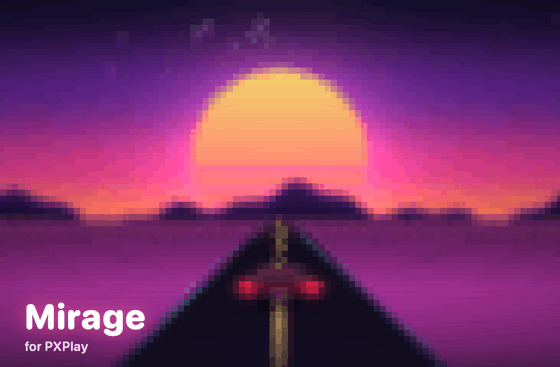
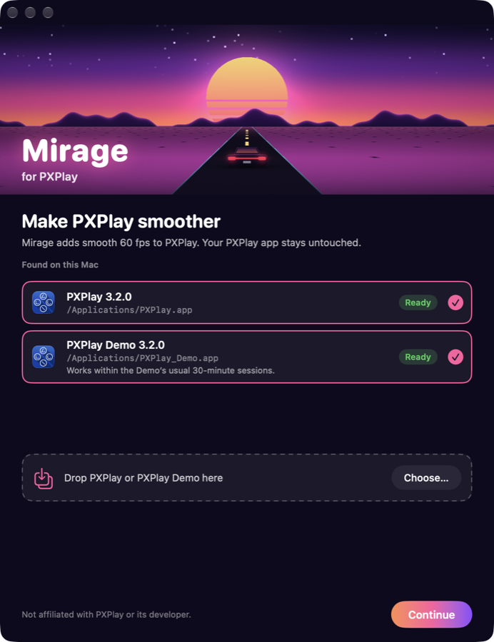
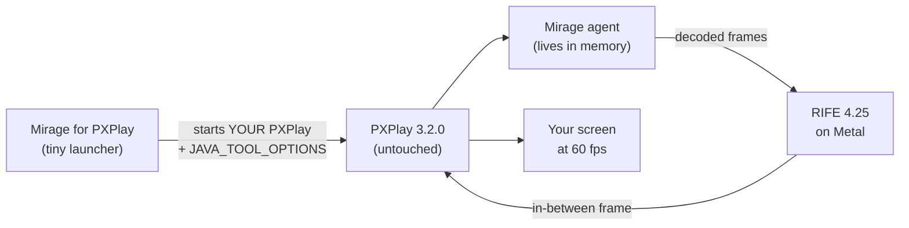

<p align="center">
  
</p>

<h1 align="center">Mirage for PXPlay</h1>

<p align="center">
  <b>60 fps PlayStation streaming on a Mac, without the input lag.</b><br>
  AI frame generation for PXPlay 3.2.0 on Apple silicon that predicts the next frame instead of waiting for it.<br>
  Free, open source, slightly magical.
</p>

<p align="center">
  
  
  
  
  <a href="https://www.patreon.com/17168801/join"></a>
</p>

<p align="center">
  <a href="https://github.com/d00d1k/mirage-for-pxplay/releases/latest"><b>⬇️ Download</b></a> ·
  <a href="#no-input-lag">Why no input lag</a> ·
  <a href="#install">Install</a> ·
  <a href="#steady-wifi">Steady Wi‑Fi warning</a> ·
  <a href="#under-the-hood">Under the hood</a> ·
  <a href="#support">⚡ Support</a> ·
  <a href="README.ru.md">По‑русски</a>
</p>

> [!IMPORTANT]
> Mirage is an independent fan project. It is **not affiliated with PXPlay or its developer (streamingdv)**.
> PXPlay is a paid app: you need your own copy of **PXPlay 3.2.0** (or **PXPlay Demo 3.2.0**).
> Mirage never copies, ships or modifies PXPlay. If you enjoy PXPlay, support its developer.

---

## ✨ What it does

Your console sends 30 frames a second. Mirage paints the ones in between on your Mac's GPU, fast enough
that your thumbs don't notice.

- 🎞 **30 → 60 fps** with RIFE 4.25, a neural network that specialises in in‑between frames, running on Metal.
- ⚡ **Prediction, not interpolation.** The real frame goes on screen the moment it arrives, and Mirage
  predicts the next one. No waiting for the future means [no extra input lag](#no-input-lag).
- 🧭 **A HUD that stays put.** Quest text, subtitles and the minimap don't wobble or smear.
- 🎛 **Three styles, zero homework.** *Recommended*, *Best picture*, *Original PXPlay*. Knobs for tinkerers live
  under *More options*.
- 📶 **Steady Wi‑Fi (optional).** Fewer lag spikes on Wi‑Fi, at a price. [Read the warning](#steady-wifi).
- 🌍 **12 languages.** Whatever PXPlay speaks, Mirage speaks.
- 🧼 **Clean in, clean out.** PXPlay stays untouched, and Uninstall puts everything back, including your PXPlay settings.

<a id="no-input-lag"></a>

## 🕹 Why there's no extra input lag

Most frame generation, including PXPlay's own, **interpolates**: it draws the frame halfway between two real
frames. To do that it has to wait until the *next* real frame has arrived, so everything you see runs a little
late. At 30 fps that's at least half a frame, about 17 ms, usually more. You feel it on the stick.

Mirage **predicts**. When a real frame arrives, it goes on screen immediately. Then RIFE's optical flow works out
where everything is heading and Mirage draws the frame that comes next. Your camera responds as fast as it does
without frame generation, only twice as smooth.

```
Interpolation   real A ··· waits for B ··· (A+B)/2 → B ···· waits for C ···· (B+C)/2 → C
Mirage          real A → predicted A+½ → real B → predicted B+½ → real C → …   (no waiting)
```

| | Interpolation (classic frame generation) | Mirage prediction |
| --- | --- | --- |
| Real frame on screen | after the next one has arrived | the moment it arrives |
| Added input lag at 30 fps | ~17 ms or more | none from frame generation |
| Generated frame | between two known frames, very clean | a guess about the future, clean most of the time |
| Weak spots | slower response | brief shimmer at edges on sudden changes |

**The honest part:** a prediction is a guess. Most of the time it's spot on. When something changes suddenly
(a camera snap, a cut, an explosion, a character stepping out from behind a wall) you may notice a short shimmer
around edges for a frame. Mirage eases off when the camera brakes, keeps the HUD still, and hands the frame back to
PXPlay when it isn't confident. If it still bothers you in a particular game, switch to **Best picture**, which
interpolates.

## 📸 Screenshots

| Finds PXPlay by itself | Pick a style | All set |
| :---: | :---: | :---: |
|  |  |  |
| Drag‑and‑drop and *Choose…* work too. Wrong versions get a red card and a link to 3.2.0. | One click for most people. Fine‑tuning waits inside PXPlay. | Open Mirage from Launchpad and play. |

## 🧰 Requirements

| | |
| --- | --- |
| **Mac** | Apple silicon (M1 or newer). Tested on M1 Max and M4. |
| **macOS** | 26 or later |
| **PXPlay** | [PXPlay 3.2.0 or PXPlay Demo 3.2.0](https://github.com/streamingdv/PSPlay-Application-Hosting/releases/tag/v3.2.0_v9.0.0), the official release. Other versions are detected and Mirage stays off. |
| **Stream** | 720p or 1080p SDR. For 4K or HDR streams, PXPlay's own frame generation takes over. |
| **Display** | 60 Hz or faster |

The Demo works too, within its usual 30‑minute sessions. Mirage doesn't touch licensing in any way.

<a id="install"></a>

## 🚀 Install in a minute

1. Download **Mirage-for-PXPlay-1.0.0.zip** from [Releases](https://github.com/d00d1k/mirage-for-pxplay/releases/latest) and unzip it.
2. Double‑click **Mirage Installer**.

   > [!NOTE]
   > Mirage isn't notarized by Apple yet, so the first time macOS stops it with *"Apple could not verify…"*.
   > Click **Done**, open **System Settings → Privacy & Security**, scroll down and click **Open Anyway** next to
   > Mirage Installer, then confirm with your password or Touch ID. You only do this once, and only for the installer.

3. The installer finds PXPlay by itself. If it doesn't, drag PXPlay onto the window or click **Choose…**.
4. Pick a style, keep **Use recommended PXPlay settings** on, and click **Install**.
5. Watch the road go from 15 fps mush to 60 fps silk. That's the whole idea of Mirage, in one animation.
6. Open **Mirage for PXPlay** from Launchpad and play.

## 🎮 Using Mirage

- **Always start PXPlay through *Mirage for PXPlay*.** Opening PXPlay directly runs plain PXPlay. Nothing breaks, it just isn't smoother.
- Settings live in **PXPlay → Settings → Video**, right under **Frame generation**. Keep Frame generation on.
- Changes apply from the next stream.

| Style | What you get | Good for |
| --- | --- | --- |
| **Recommended** | Prediction mode, strength 70%, strong smoothing when the camera slows down | Almost everything |
| **Best picture** | Interpolation: blends between two real frames, cleanest image, adds some delay | Slower games, when image quality matters more than latency |
| **Original PXPlay** | PXPlay's own frame generation, Mirage steps aside | Comparing, or if something ever looks off |

With PXPlay's performance overlay on, the full version shows **Mirage 30→60** while Mirage is generating frames.
A percentage such as *Mirage 87%* means the Mac was occasionally late, and PXPlay filled in those frames.

<a id="steady-wifi"></a>

## ⚠️ Steady Wi‑Fi: read this before you tick the box

> [!WARNING]
> **Steady Wi‑Fi switches off AirDrop and other "nearby device" features while PXPlay is open.**
> It's **off by default**, it needs your **administrator password once**, and it's a trick Apple doesn't officially support.

**Why it exists.** Macs keep a hidden radio link called AWDL (`awdl0`) for AirDrop and friends. Every few hundred
milliseconds it pulls your Wi‑Fi chip away to another channel to look for nearby devices. That's great for AirDrop
and bad for a game stream: those hops show up as lag spikes and lost packets. Steady Wi‑Fi pauses AWDL while PXPlay
is open, the same trick other "low lag" tools use.

**What you give up while PXPlay is open:** AirDrop, AirPlay to nearby devices, Sidecar, iPhone Mirroring,
Universal Control and Continuity Camera may not work. Your normal Wi‑Fi, internet and Bluetooth keep working.

**How it works.** macOS asks for your password once to install a tiny helper: a launchd job plus a ~40‑line shell
script in `/Library`. It only acts while a PXPlay started by Mirage is running, and it brings AWDL back as soon as
PXPlay quits.

**Good to know:**
- It helps on Wi‑Fi. On Ethernet there's nothing to fix.
- To turn it off: **PXPlay → Settings → Video → Mirage → Steady Wi‑Fi while streaming**.
- If AirDrop ever seems stuck after a crash, quit PXPlay or restart the Mac. Or run this in Terminal:
  ```bash
  sudo ifconfig awdl0 up
  ```
- **Uninstall** removes the helper. To remove it by hand, run these three commands one by one:
  ```bash
  sudo launchctl bootout system/io.github.mirage-pxplay.steady-wifi
  ```
  ```bash
  sudo rm /Library/LaunchDaemons/io.github.mirage-pxplay.steady-wifi.plist /Library/PrivilegedHelperTools/io.github.mirage-pxplay.steady-wifi
  ```
  ```bash
  sudo ifconfig awdl0 up
  ```

## 🔧 How it works



1. **The launcher** starts the PXPlay you installed, wherever it lives, and attaches Mirage's Java agent.
   If you move PXPlay, the launcher finds it again.
2. **The agent checks** that this really is PXPlay 3.2.0 for Apple silicon: version, files, the developer's code
   signature and fingerprints of the exact classes it touches. For anything else, Mirage politely stays off.
3. **It joins in** on PXPlay's frame‑generation calls and hands decoded frames to RIFE a little early.
4. **RIFE draws the frame on the GPU.** If it's ever late, PXPlay's own frame fills in, so you never get a stutter
   because of Mirage.

<a id="under-the-hood"></a>

## 🧪 Under the hood

Explained with a straight face. Mostly.

- **A polite burglar.** A JVMTI agent written in Objective‑C comes in through `JAVA_TOOL_OPTIONS`, wipes its feet,
  and never touches a single PXPlay file on disk.
- **Surgery in RAM.** JDK 25's `java.lang.classfile` API adds exactly two lines of bytecode to two classes while they
  load. Quit PXPlay and the scars are gone.
- **A neural network with a sixth sense.** RIFE 4.25 (Practical‑RIFE by hzwer), via `rife-metal` and OpenDuckFrame's
  four‑stage ODF‑VFI layout, on Metal Performance Shaders Graph. It has seen more in‑between frames than an animation
  studio intern.
- **Fortune telling, responsibly.** Prediction mode shows the real frame first, then extrapolates the next one from
  RIFE's optical flow. When the camera brakes it eases off, so the picture doesn't overshoot like a cartoon.
- **One Metal pass to rule them all.** Custom compute shaders convert NV12 ↔ BGRA, blend frames and keep the HUD
  still. The logic is simple: if a pixel hasn't moved for three frames, it's probably your minimap.
- **An installer with a character arc.** SwiftUI and a procedurally drawn Metal scene that starts at a choppy 15 fps
  on purpose and grows up to 60 fps as the files are copied. No game footage was harmed.
- **A root helper with trust issues.** A tiny shell script under launchd. It reads exactly one number from one file,
  checks that it belongs to a running PXPlay, and touches nothing else.
- **Twelve languages,** because PXPlay speaks twelve and we didn't want to be the odd one out.

## 🔄 PXPlay updates

PXPlay never updates by itself. When a new version comes out, it shows a notice once with **OK** and **Download**.
Choose **OK** to keep Mirage working. If you do install a newer PXPlay, Mirage switches itself off until a Mirage
update supports it. Nothing breaks: you simply get plain PXPlay.

## 🧹 Uninstall

Open **Mirage Installer** and click **Uninstall**. It removes Mirage, its launchers and the Wi‑Fi helper, and can
restore your previous PXPlay settings. PXPlay itself is never touched.

<details>
<summary>Where Mirage keeps its files</summary>

| What | Where |
| --- | --- |
| Mirage itself | `~/Library/Application Support/Mirage for PXPlay/` |
| Launchers | `~/Applications/Mirage for PXPlay.app`, `~/Applications/Mirage for PXPlay Demo.app` |
| Logs | `~/Library/Logs/Mirage for PXPlay/` |
| Steady Wi‑Fi helper (optional) | `/Library/LaunchDaemons/io.github.mirage-pxplay.steady-wifi.plist`, `/Library/PrivilegedHelperTools/io.github.mirage-pxplay.steady-wifi` |

</details>

## ❓ FAQ

**Does it change anything on my console or in my PSN account?**
No. Mirage only changes how frames are shown on your Mac. What PXPlay sends to your console stays exactly the same.

**Intel Mac?**
No. RIFE needs Apple silicon's GPU and neural muscle.

**Why does macOS warn about the developer?**
The installer isn't signed with a paid Apple Developer ID and notarized yet. Signing would remove the warning, and
it's on the list.

**Something looks off in a game.**
Switch to *Best picture* or *Original PXPlay* in PXPlay → Settings → Video. If you open an issue, attach
`~/Library/Logs/Mirage for PXPlay/PXPlay.log`.

## 🛠 Build from source

You'll need Xcode 26, a JDK 25 (`JAVA_HOME`) and PXPlay 3.2.0 installed. Its JavaFX jars are used to compile the
settings panel; nothing from PXPlay ends up in the build.

```bash
./build.sh                 # → build/Mirage Installer.app and build/Mirage-for-PXPlay-<version>.zip
Tests/run-test.sh          # agent, RIFE on a mock renderer, settings panel, languages, Wi-Fi helper
Tests/smoke-test.sh        # installer: detection, validation, install, launcher, uninstall
Tests/smoke-test.sh --live # also starts the real PXPlay once and checks the agent loaded
```

The project and donation links shown in the installer are set in `release.config`.

<a id="support"></a>

## ⚡ Support

Mirage is free and open source, and it's staying that way. No features behind a paywall, ever.

That said, it does run on Monster Ultra White. If Mirage saved your thumbs some input lag, you can
**[buy me a can on Patreon](https://www.patreon.com/17168801/join)**. I've got a list of ideas to make it even smoother, sharper and
lower‑latency, and every can gets them a little closer to your screen. ⚡

Starring the repo and telling a friend with a Mac and a PS5 helps just as much. ⭐

## 🙏 Credits

- **[PXPlay](https://github.com/streamingdv/PSPlay-Application-Hosting/releases)** by streamingdv. The app that makes all of this possible. Buy it.
- **[Practical‑RIFE](https://github.com/hzwer/Practical-RIFE)** by hzwer: the RIFE 4.25 model (MIT).
- **[rife-metal](https://github.com/cinemore/rife-metal)** by xzhih: RIFE on Metal (Apache 2.0).
- **[OpenDuckFrame](https://github.com/Jun-bao/OpenDuckFrame)** contributors: the prepared runtime and the ODF‑VFI layout (MIT).

## 📄 License

Mirage's own code is MIT‑licensed ([LICENSE](LICENSE)). Third‑party parts keep their licenses, see
[THIRD-PARTY-NOTICES.md](THIRD-PARTY-NOTICES.md). PXPlay, PlayStation and other names are trademarks of their owners.
