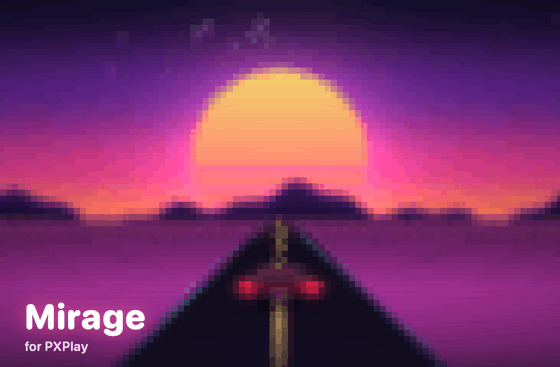

<p align="center">
  
</p>

<h1 align="center">Mirage for PXPlay</h1>

<p align="center">
  <b>60 fps в стриме PlayStation на Mac — без инпут‑лага.</b><br>
  ИИ‑генерация кадров для PXPlay 3.2.0 на Apple Silicon, которая предсказывает следующий кадр, а не ждёт его.<br>
  Бесплатно, с открытым кодом и щепоткой магии.
</p>

<p align="center">
  <a href="https://github.com/d00d1k/mirage-for-pxplay/releases/latest"><b>⬇️ Скачать</b></a> ·
  <a href="#no-input-lag">Почему нет инпут‑лага</a> ·
  <a href="#install">Установка</a> ·
  <a href="#steady-wifi">Про стабильный Wi‑Fi</a> ·
  <a href="#support">⚡ Поддержать</a> ·
  <a href="README.md">English</a>
</p>

> [!IMPORTANT]
> Mirage — независимый фанатский проект, **не связанный с PXPlay и его разработчиком (streamingdv)**.
> PXPlay — платное приложение: нужен твой собственный **PXPlay 3.2.0** (или **PXPlay Demo 3.2.0**).
> Mirage не копирует, не распространяет и не изменяет PXPlay. Нравится PXPlay — поддержи его автора.

## ✨ Что делает

Консоль присылает 30 кадров в секунду. Mirage дорисовывает промежуточные на видеокарте Mac так быстро, что пальцы
на геймпаде этого не замечают.

- 🎞 **30 → 60 fps** с помощью RIFE 4.25: нейросети, которая специализируется на промежуточных кадрах, на Metal.
- ⚡ **Прогноз, а не интерполяция.** Настоящий кадр сразу идёт на экран, а следующий Mirage предсказывает. Будущее не ждём — [лишнего инпут‑лага нет](#no-input-lag).
- 🧭 **HUD не плывёт.** Маленькая нейросеть на Neural Engine отличает интерфейс от игрового мира, и прицел, миникарта и меню остаются на месте.
- 🎛 **Три стиля, без домашки.** «Рекомендуемый», «Максимальная картинка», «Штатный PXPlay». Ручки для любителей — в «Дополнительно».
- 📶 **Стабильный Wi‑Fi (по желанию).** Меньше пиков задержки, но с ценой. [Прочитай предупреждение](#steady-wifi).
- 🌍 **12 языков** — на каком языке PXPlay, на таком и Mirage.
- 🧼 **Чисто ставится и чисто удаляется.** PXPlay не трогается, «Удалить» возвращает всё, включая твои настройки PXPlay.

<a id="no-input-lag"></a>

## 🕹 Почему нет лишнего инпут‑лага

Почти вся генерация кадров, включая собственную в PXPlay, **интерполирует**: рисует кадр посередине между двумя
настоящими. Для этого ей нужно дождаться *следующего* настоящего кадра, поэтому всё на экране чуть опаздывает.
При 30 fps это минимум полкадра, около 17 мс, обычно больше. Стик это чувствует.

Mirage **предсказывает**. Настоящий кадр уходит на экран сразу, как пришёл. Потом по оптическому потоку RIFE Mirage
понимает, куда всё движется, и дорисовывает следующий кадр. Камера откликается так же быстро, как без генерации кадров,
только вдвое плавнее.

```
Интерполяция   кадр A ··· ждём B ··· (A+B)/2 → B ···· ждём C ···· (B+C)/2 → C
Mirage         кадр A → прогноз A+½ → кадр B → прогноз B+½ → кадр C → …   (без ожидания)
```

| | Интерполяция (обычная генерация кадров) | Прогноз Mirage |
| --- | --- | --- |
| Настоящий кадр на экране | после прихода следующего | сразу, как пришёл |
| Добавочный инпут‑лаг при 30 fps | ~17 мс и больше | от генерации кадров — нет |
| Сгенерированный кадр | между двумя известными, очень чистый | догадка о будущем, чистая почти всегда |
| Слабое место | медленнее отклик | короткая рябь на краях при резких изменениях |

**Честно о главном:** прогноз — это догадка. Почти всегда она точная. Когда что‑то меняется резко (рывок камеры,
смена сцены, взрыв, персонаж выходит из‑за стены), на долю секунды может мелькнуть рябь по краям. Mirage сбавляет
прогноз при торможении камеры, держит HUD на месте и отдаёт кадр PXPlay, если не уверен. Если в какой‑то игре это
всё равно мешает, включи **«Максимальная картинка»** — там интерполяция.

## 🧰 Что нужно

| | |
| --- | --- |
| **Mac** | Apple Silicon (M1 и новее). Проверено на M1 Max и M4. |
| **macOS** | 26 или новее |
| **PXPlay** | [PXPlay 3.2.0 или PXPlay Demo 3.2.0](https://github.com/streamingdv/PSPlay-Application-Hosting/releases/tag/v3.2.0_v9.0.0) — официальный релиз. На других версиях Mirage не включается. |
| **Стрим** | 720p или 1080p SDR. Для 4K и HDR работает собственная генерация кадров PXPlay. |
| **Экран** | 60 Гц и выше |

Демо‑версия тоже работает в рамках своих 30‑минутных сессий. Лицензирование Mirage никак не трогает.

<a id="install"></a>

## 🚀 Установка за минуту

1. Скачай последний zip **Mirage-for-PXPlay** в [Releases](https://github.com/d00d1k/mirage-for-pxplay/releases/latest) и распакуй.
2. Дважды щёлкни **Mirage Installer**.

   > [!NOTE]
   > Mirage пока не заверен Apple, поэтому в первый раз macOS его остановит. Нажми **Готово**, открой
   > **Системные настройки → Конфиденциальность и безопасность**, пролистай вниз и нажми **Всё равно открыть** рядом
   > с Mirage Installer, затем подтверди паролем или Touch ID. Это нужно один раз и только для установщика.

3. Установщик сам найдёт PXPlay. Если нет — перетащи PXPlay в окно или нажми **Выбрать…**.
4. Выбери стиль, оставь **Применить рекомендуемые настройки PXPlay** и нажми **Установить**.
5. Смотри, как дорога превращается из рваных 15 fps в шёлковые 60 fps. В этом весь смысл Mirage, в одной анимации.
6. Открывай **Mirage for PXPlay** из Launchpad и играй.

## 🎮 Как пользоваться

- **Запускай PXPlay через «Mirage for PXPlay».** Если открыть PXPlay напрямую, он запустится обычным, без Mirage.
- Настройки: **PXPlay → Настройки → Видео**, сразу под **Frame generation**. Frame generation должна быть включена.
- Изменения применяются со следующего стрима.
- **MacBook Pro с ProMotion:** для 30 → 60 переключи экран на **60 Гц** (Системные настройки → Дисплеи → Частота
  обновления → 60 Гц). Так vsync и равномерность кадров работают чисто. После игры можно вернуть ProMotion.
- **Сомневаешься?** Mirage работает и с бесплатной **PXPlay Demo**. Попробуй сначала на ней, а понравится — купи PXPlay.

| Стиль | Что получаешь | Для чего |
| --- | --- | --- |
| **Рекомендуемый** | Прогноз, сила 70%, сильное сглаживание при торможении камеры | Почти для всего |
| **Максимальная картинка** | Интерполяция: смешивание двух настоящих кадров, самая чистая картинка, задержка чуть больше | Неспешные игры, когда картинка важнее задержки |
| **Штатный PXPlay** | Собственная генерация кадров PXPlay, Mirage в сторонке | Сравнить, или если что‑то выглядит не так |

<a id="steady-wifi"></a>

## ⚠️ Стабильный Wi‑Fi: прочитай, до того как ставить галочку

> [!WARNING]
> **Пока открыт PXPlay, стабильный Wi‑Fi выключает AirDrop и другие функции «устройств рядом».**
> По умолчанию он **выключен**, один раз попросит **пароль администратора**, и это трюк, который Apple официально не поддерживает.

**Зачем он нужен.** У Mac есть скрытый радиоканал AWDL (`awdl0`) для AirDrop и похожих функций. Каждые несколько сотен
миллисекунд он уводит Wi‑Fi на другой канал искать устройства рядом. Для AirDrop это хорошо, а для стрима это пики
задержки и потерянные пакеты. Стабильный Wi‑Fi ставит AWDL на паузу, пока открыт PXPlay. Это тот же трюк, что и в
других программах «low lag».

**Что не будет работать, пока открыт PXPlay:** AirDrop, AirPlay на устройства рядом, Sidecar, повтор экрана iPhone,
Universal Control и камера iPhone. Обычный Wi‑Fi, интернет и Bluetooth работают как всегда.

**Как устроено.** macOS один раз спрашивает пароль и ставит крошечный помощник: задачу launchd и короткий
shell‑скрипт в `/Library`. Он работает только пока открыт PXPlay, запущенный через Mirage, и возвращает AWDL сразу
после выхода из PXPlay.

**Полезно знать:**
- Помогает на Wi‑Fi. С кабелем Ethernet чинить нечего.
- Выключить: **PXPlay → Настройки → Видео → Mirage → Стабильный Wi‑Fi во время стрима**.
- Если после сбоя AirDrop не оживает, закрой PXPlay или перезагрузи Mac. Или выполни в Терминале:
  ```bash
  sudo ifconfig awdl0 up
  ```
- «Удалить» в установщике убирает помощник. Вручную — тремя командами по очереди:
  ```bash
  sudo launchctl bootout system/io.github.mirage-pxplay.steady-wifi
  ```
  ```bash
  sudo rm /Library/LaunchDaemons/io.github.mirage-pxplay.steady-wifi.plist /Library/PrivilegedHelperTools/io.github.mirage-pxplay.steady-wifi
  ```
  ```bash
  sudo ifconfig awdl0 up
  ```

## 🧠 Новое в 1.1: нейросеть для HUD

Теперь Mirage запускает на **Neural Engine** маленькую нейросеть (около 240 тысяч параметров), которая отличает
интерфейс от игрового мира. Она обучена на реальных записях геймплея GTA 6 и находит прицел, счётчики патронов и
здоровья, миникарту, подсказки и меню. Они остаются чёткими и неподвижными, пока остальной кадр дорисовывается, а
персонажей, кепки и водителей она больше не путает с HUD.

Сеть работает вместе с прежними правилами «не двигалось три кадра» и только дополняет их. Она отстаёт на один кадр и
никогда не задерживает вывод, поэтому не тратит время видеокарты и не добавляет задержки. Если Neural Engine занят
или модель не загрузилась, Mirage тихо работает по одним правилам. Настроена она на GTA 6, в других играх просто
помогает меньше.

## 🧪 Что под капотом

С серьёзным лицом. Почти.

- **Вежливый взломщик.** JVMTI‑агент на Objective‑C входит через `JAVA_TOOL_OPTIONS`, вытирает ноги и не трогает ни одного файла PXPlay на диске.
- **Хирургия в оперативке.** API `java.lang.classfile` из JDK 25 добавляет ровно две строки байткода в два класса прямо при загрузке. Закрыл PXPlay — и шрамов нет.
- **Нейросеть с шестым чувством.** RIFE 4.25 (Practical‑RIFE от hzwer) через `rife-metal` и четырёхступенчатую схему ODF‑VFI от OpenDuckFrame на Metal Performance Shaders Graph. Видела больше промежуточных кадров, чем стажёр анимационной студии.
- **Гадание на кофейной гуще, но ответственно.** Прогноз показывает настоящий кадр первым, а следующий достраивает по оптическому потоку RIFE. Когда камера тормозит, прогноз сбавляет обороты, чтобы картинка не «проезжала», как в мультике.
- **Один проход Metal, чтобы править всеми.** Свои шейдеры переводят NV12 ↔ BGRA, смешивают кадры и держат HUD на месте. Логика простая: если пиксель не двигался три кадра, это, скорее всего, твоя миникарта.
- **Установщик с развитием персонажа.** SwiftUI и нарисованная на Metal сцена, которая нарочно начинает с рваных 15 fps и дорастает до 60 fps, пока копируются файлы. Ни один кадр из игр не пострадал.
- **Root‑помощник с недоверием к миру.** Крошечный скрипт под launchd читает ровно одно число из одного файла, проверяет, что это запущенный PXPlay, и больше ничего не трогает.
- **Двенадцать языков**, потому что PXPlay говорит на двенадцати.

## 🔄 Обновления PXPlay

PXPlay сам не обновляется. Когда выходит новая версия, он один раз показывает окно с **OK** и **Download**. Нажми **OK**,
чтобы Mirage продолжал работать. Если всё же поставить новую версию, Mirage просто выключится, пока не выйдет его
обновление. Ничего не ломается, будет обычный PXPlay.

## 🧹 Удаление

Открой **Mirage Installer** и нажми **Удалить**. Он уберёт Mirage, ярлыки и помощник Wi‑Fi и может вернуть твои
прежние настройки PXPlay. Сам PXPlay не затрагивается.

## ❓ Вопросы

**Это что‑то меняет на консоли или в аккаунте PSN?**
Нет. Mirage меняет только то, как кадры показываются на Mac. Всё, что PXPlay отправляет на консоль, остаётся прежним.

**Mac на Intel?**
Нет, RIFE нужна видеокарта Apple Silicon.

**Почему macOS ругается на разработчика?**
Установщик пока не подписан платным сертификатом Apple Developer ID и не нотаризован. Подпись уберёт предупреждение, это в планах.

**В игре что‑то выглядит странно.**
Переключись на «Максимальная картинка» или «Штатный PXPlay» в PXPlay → Настройки → Видео. Если пишешь в Issues,
приложи `~/Library/Logs/Mirage for PXPlay/PXPlay.log`.

<a id="support"></a>

## ⚡ Поддержать

Я сделал Mirage, потому что 30 fps меня просто бесят, а мощного игрового ПК у меня нет — только PS5 и Mac на Apple Silicon.
Если у тебя так же, теперь и у тебя есть генерация кадров. Это бесплатно и останется бесплатным.

Если хочешь сказать спасибо, есть [Patreon](https://www.patreon.com/17168801/join) (банка Monster Ultra White помогает в ночных посиделках ⚡),
а звёздочка репозиторию значит не меньше.

## 🙏 Спасибо

- **PXPlay** от streamingdv — без него ничего этого не было бы. Купите его.
- **Practical‑RIFE** от hzwer — модель RIFE 4.25 (MIT).
- **rife-metal** от xzhih — RIFE на Metal (Apache 2.0).
- Авторам **OpenDuckFrame** — подготовленный рантайм и схема ODF‑VFI (MIT).

## 📄 Лицензия

Код Mirage — под MIT ([LICENSE](LICENSE)). Сторонние части — под своими лицензиями, см.
[THIRD-PARTY-NOTICES.md](THIRD-PARTY-NOTICES.md). PXPlay, PlayStation и другие названия — товарные знаки их владельцев.
